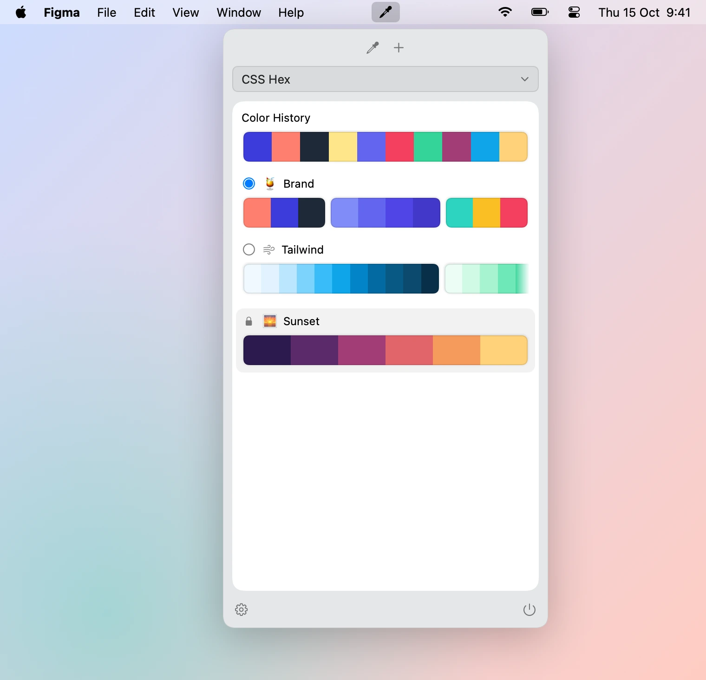
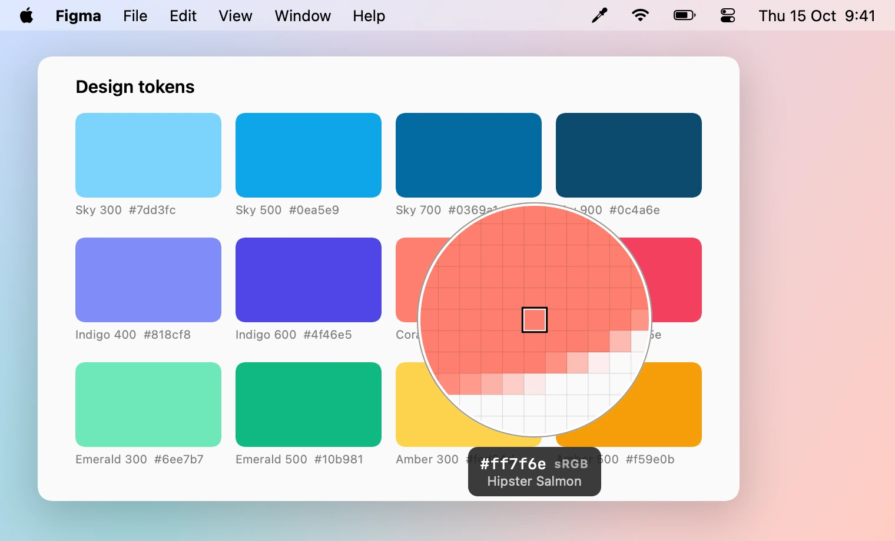
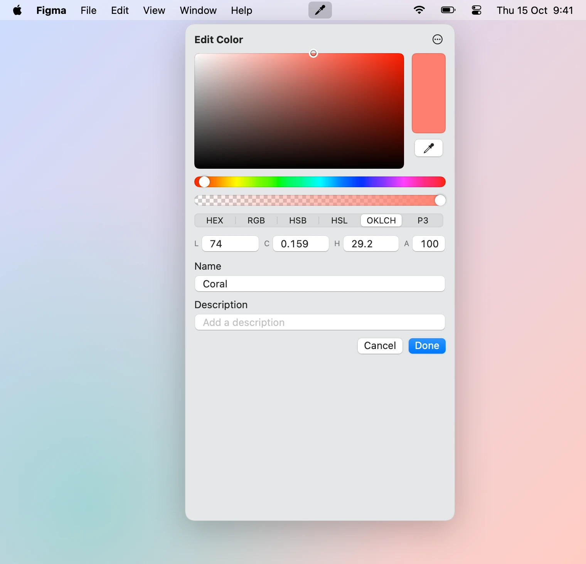
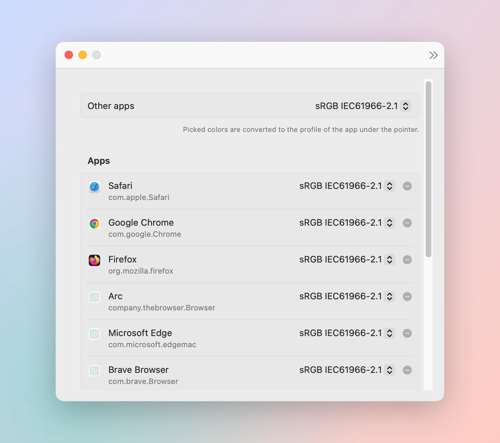

# Colorsip

A color-picker menubar app for macOS. Pick colors from anywhere on screen, keep them in palettes
with named groups, and copy or paste them in the format you need: CSS, SwiftUI, AppKit, UIKit or
Android.

<picture>
  <source media="(prefers-color-scheme: dark)" srcset="docs/popover-dark.webp">
  
</picture>

Colorsip is open source (MIT) and distributed as source only: there are no pre-built binaries and
no App Store version. You build it yourself (see [Build from source](#build-from-source)).

The current release is 1.0.0. What changed in each release is in [`CHANGELOG.md`](CHANGELOG.md),
and the product spec is in [`spec.md`](spec.md).

## Features

- **Menubar popover.** Click the eyedropper in the menubar for your palettes. Click a swatch to
  copy it in the active format; right-click for Copy as…, Edit…, Rename and Delete. ⌘Z and ⇧⌘Z undo
  and redo every change.
- **Palettes with groups.** Give a palette an emoji or SF Symbol icon and a description, split it
  into named groups, duplicate it, or lock it against changes. The radio button picks the palette
  new picks go into.
- **Starter Palettes.** Add the Tailwind CSS v4 color palettes to your library, one at a time or
  all at once, in Settings ▸ Palettes.
- **Color History.** The last 16 picks, newest first. Picking a color again moves it to the front.
- **Picker and loupe.** A magnified pixel grid that follows the pointer across displays, with the
  color's friendly name (from about 30,000 names) and value under it. Hold Option to switch the
  output format without leaving the picker.
- **Color profiles (Smart Profiles).** A pick is converted to the profile of the app under the
  pointer: sRGB for browsers and Figma, Display P3 for Xcode, Sketch, Pixelmator Pro and Preview.
  You can change the list and the fallback in Settings ▸ Profiles.
- **Cmd+click paste.** Pick a color and paste it straight into the app you were working in.
- **Color editor.** A compact editor with HEX, RGB, HSB, HSL, OKLCH and Display P3 fields, alpha
  and an eyedropper.
- **Drag and drop.** Drag swatches between palettes and groups (Option copies), or out to other
  apps as text in the active format.
- **Lossless colors.** Colors keep the space they were picked or edited in, with float
  components. Nothing is rounded until you copy it.
- **Sound effects.** A slurp when you pick and a plopp when you copy. You can turn them off in
  Settings ▸ General.

### The picker

<picture>
  <source media="(prefers-color-scheme: dark)" srcset="docs/picker-dark.webp">
  
</picture>

Start the picker with **⌃⌥⌘P** or the eyedropper in the popover. The label under the loupe shows
a swatch, the color's name and its value in the active format, with the profile it was converted
to below. Small badges show what the next click does: a stack while Shift is held (keep
picking), a paper plane while Cmd is held (paste).

| Input | Action |
|---|---|
| Click, Return or Space | Pick the color and close the picker |
| Shift+click | Pick the color and keep the picker open |
| Cmd+click | Pick the color, close the picker and paste the value into the active app |
| Arrow keys | Move one pixel (a physical pixel of the display) |
| Shift+arrow keys | Move ten pixels |
| Mouse wheel | Resize the loupe (120–400 pt) |
| Option+mouse wheel | Change the grid size (5–31 pixels across) |
| Hold Option | Show the format menu. Click a format to make it the active one; the label changes at once |
| Esc | Close the picker. Colors you already picked with Shift+click are kept |

Every pick goes into Color History and into the palette whose radio button is on (unless it is
locked), and its value is copied to the clipboard. Settings ▸ Picker sets the loupe size and grid
size it starts with.

### Output formats

Choose the active format in the popover's format menu. Right-click a swatch to copy it in any
other format.

| Format | Example |
|---|---|
| CSS Hex | `#3c3cdb` (`#3c3cdbcc` with alpha) |
| CSS Hex (no #) | `3c3cdb` |
| CSS RGB | `rgb(60 60 219)` (`rgb(60 60 219 / 80%)` with alpha) |
| CSS HSL | `hsl(240 68.83% 54.71%)` |
| CSS OKLCH | `oklch(47.5% 0.233 273.1)` |
| CSS Display P3 | `color(display-p3 0.236 0.235 0.859)` |
| SwiftUI | `Color(.displayP3, red: 0.236, green: 0.235, blue: 0.859, opacity: 1)` |
| NSColor | `NSColor(displayP3Red: 0.236, green: 0.235, blue: 0.859, alpha: 1)` |
| UIColor | `UIColor(displayP3Red: 0.236, green: 0.235, blue: 0.859, alpha: 1)` |
| Android | `0xFF3C3CDB` |
| Android (XML) | `#FF3C3CDB` |

The Swift formats use the color's own space (sRGB or Display P3). Formats that can't hold a color's
gamut, such as Hex for a vivid P3 color, get it gamut-mapped to sRGB the way CSS Color 4 does.

### Color editor

<picture>
  <source media="(prefers-color-scheme: dark)" srcset="docs/editor-dark.webp">
  
</picture>

Right-click a swatch and choose **Edit…**. The eyedropper re-picks the color from the screen; the
**…** menu has Copy as and Reset. The editor remembers which set of fields you used last.

## Shortcuts

| Shortcut | Action |
|---|---|
| **⌃⌥⌘P** | Start the picker, from any app |
| ⌘Z / ⇧⌘Z | Undo / redo, in the popover |

To change the picker shortcut, open **Settings ▸ Shortcuts**, click the shortcut, and press the new
combination. Esc cancels and ⌫ removes the shortcut. Colorsip refuses combinations without a
modifier, combinations macOS uses for its own shortcuts, and combinations another app has
registered. The global shortcut needs no permission.

<picture>
  <source media="(prefers-color-scheme: dark)" srcset="docs/settings-dark.webp">
  
</picture>

## Requirements

- macOS 15.8 or later
- Xcode 26 or later

## Build from source

```sh
git clone --branch v1.0.0 https://github.com/nicbet/colorsip.git
cd colorsip
make build
```

Leave out `--branch v1.0.0` to build the latest unreleased code on `main`. This builds
`Builds/Colorsip.app`. To install it, copy it into `/Applications`. Run `make` for the
other tasks.

You can also open `Colorsip.xcodeproj`, select the **Colorsip** scheme and press **Run** (⌘R). The
project uses "Sign to Run Locally", so you don't need an Apple Developer account.

Colorsip is an agent app: it has no Dock icon. Look for the eyedropper in the menubar.

## Grant permissions

Colorsip needs two macOS permissions. At launch, and when you use a feature that needs one, a
guide walks you through the missing ones: it opens the right pane of **System Settings → Privacy &
Security** and ticks each permission off as soon as you turn Colorsip on. No restart is needed.
Accessibility is optional and can be skipped. **Settings ▸ Permissions** shows what's granted and
starts the guide again.

| Permission | Needed for |
|---|---|
| **Screen & System Audio Recording** | Reading pixel colors under the picker |
| **Accessibility** | Cmd+click paste into the active app. Without it, Cmd+click only copies |

### Keep permissions across rebuilds

By default the app is signed ad hoc, and macOS ties these permissions to that one build. After a
rebuild, Colorsip still shows as allowed in System Settings, but the permission no longer applies
and the guide comes back.

To fix that, create a local code-signing certificate once:

```sh
make signing-cert
```

This creates a self-signed certificate named "Colorsip Local Signing" in your login keychain,
trusts it for code signing only (macOS asks for your password), and writes the untracked
`Config/Signing.local.xcconfig` so Xcode signs with it too. `make build` uses it whenever it is in
your keychain. On the first signed build, macOS asks whether `codesign` may use the key: click
**Always Allow**.

Then clear the old grants and grant the permissions once more:

```sh
make reset-permissions
```

Without the certificate, run `make reset-permissions` (or remove Colorsip from the list in System
Settings) after a rebuild, then grant again.

## Your library and the `.colorsip` format

Colorsip keeps your library in a folder of plain files:

```
~/Library/Application Support/Colorsip/Library/
  library.json              # palette order, pick target, format version
  history.json              # Color History
  settings.json             # shortcuts, formats, profiles, loupe defaults
  palettes/<uuid>.colorsip  # one file per palette
```

Each palette is a `.colorsip` file: UTF-8 JSON in the
[W3C Design Tokens (DTCG)](https://www.designtokens.org/) format. Groups are DTCG groups and
swatches are `color` tokens, with Colorsip's own data (ids, icon, lock, order, timestamps) under
`$extensions["app.colorsip"]`. The JSON Schema is
[`schema/colorsip-palette.schema.json`](schema/colorsip-palette.schema.json), so other tools can
read and validate these files.

Import and export (Colorsip, ASE, CLR, JSON and PDF) are planned for a later release. Until then,
you can back up or share a palette by copying its file. Quit Colorsip before you put a file into
`palettes/`.

## Known limitations

- **Color accuracy on some external displays.** Colorsip samples the screen in extended linear
  Display P3, so it adds no error of its own. But some displays have a color profile that clips
  colors (on some panels even sRGB blue and yellow) before any app can read them, and no picker
  can recover the original value. On such a display, `#0000ff` may read as `#1a00ff`. Other pickers
  show the same error.
- **Recurring screen-capture prompt.** macOS 15 and later ask again from time to time whether
  Colorsip may keep capturing the screen. Click **Allow** to keep using the picker.
- **Cmd+click paste needs Accessibility.** Without it, the value is only copied.
- **Not in this release.** The main window, import and export, the contrast checker, color vision
  simulation, per-app output formats, templates and folder sync come in later releases (see
  [`spec.md`](spec.md)).

## Development

The project has two parts:

- `Packages/ColorsipCore`: a Swift package with no UI. It holds the color model, conversions,
  formatters, naming, contrast math, the storage model and serialization.
- `Colorsip`: the app target (menubar, picker, windows, settings).

Run the Core tests:

```sh
make test
```

CI (GitHub Actions) runs the Core tests and builds the app on every push and pull request.

The picker draws on screen and can't be fully tested automatically. To check it by hand, open
`TestPages/picker-swatches.html` in Safari. It has sRGB and Display P3 swatches labelled with
the values the picker should show, and 1-pixel patterns for checking the loupe grid and arrow keys.

The screenshots in `docs/` are rendered by the app itself from a sample library
(`make screenshots`, needs `cwebp` from `brew install webp`). `make snapshot` renders them, light
and dark, to `Builds/snapshots/`. Both render offscreen, so they need no permission and don't touch
your library.

## License

MIT. See [`LICENSE`](LICENSE).

## Third-party

- Color names come from [meodai/color-name-list](https://github.com/meodai/color-name-list)
  v14.54.2 by David Aerne, MIT licensed. The list and its license are bundled in
  `Packages/ColorsipCore/Sources/ColorsipCore/Resources/`. To update it, replace `colornames.csv`
  with the `dist/colornames.csv` of a newer `color-name-list` npm release, and update the version
  here, in `Package.swift`, and in the entry-count test.
- Starter palette colors come from [Tailwind CSS](https://github.com/tailwindlabs/tailwindcss)
  v4.1.18, MIT licensed. The pinned `theme.css` and Tailwind license are bundled in
  `Packages/ColorsipCore/Sources/ColorsipCore/Resources/`.
